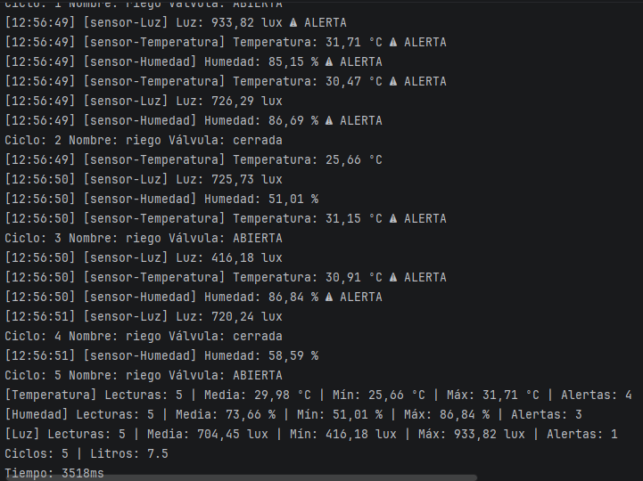

# Invernadero con hilos

Sistema de monitorización concurrente y automatización para invernaderos desarrollado en Java. El proyecto
modela la adquisición de datos de sensores ambientales y el accionamiento de actuadores de riego mediante programación
multihilo nativa (`Thread` y `Runnable`), comparando las diferencias de rendimiento y ciclo de vida entre ejecuciones
secuenciales y concurrentes.

---

## Qué hace

El sistema automatiza el control ambiental de un invernadero gestionando múltiples dispositivos concurrentes:

- **Sensor de Temperatura (`Runnable`):** Registra lecturas entre 15,0 °C y 35,0 °C cada 400 ms (rango óptimo: 18–30
  °C).
- **Sensor de Humedad (`Runnable`):** Registra lecturas entre 40,0 % y 90,0 % cada 600 ms (rango óptimo: 50–80 %).
- **Sensor de Luz (`Runnable`):** Registra lecturas entre 0 y 1000 lux cada 500 ms (rango óptimo: 200–900 lux).
- **Programador de Riego (`Thread`):** Ejecuta 5 ciclos alternando el estado de la válvula (`ABIERTA` / `cerrada`) cada
  700 ms, suministrando 2,5 L de agua en cada apertura.
- **Vigilante (`Runnable` / Demonio):** Monitoriza el estado del ciclo de vida (`Thread.State`) de todos los hilos del
  sistema cada 300 ms sin bloquear la finalización de la JVM.

Cada dispositivo registra 5 lecturas o ciclos. Los sensores detectan anomalías fuera de rango emitiendo alertas y
generan un informe final con media, mínimo, máximo y número de alertas. El riego emite un informe con los ciclos
realizados y el volumen total de agua consumida.

---

## Cómo ejecutarlo

1. Clonar el repositorio público de GitHub:
   ```bash
   git clone https://github.com/daa0010/psp-ud4-invernadero.git
   cd psp-ud4-invernadero
   ```
2. Abrir el proyecto en IntelliJ IDEA configurado con **JDK 21**.
3. Ejecutar las clases principales de cada fase desde la carpeta `src`:
    - `Fase1_Secuencial.java`: Ejecución secuencial síncrona en el hilo principal.
    - `Fase2_Concurrente.java`: Ejecución paralela multihilo con sincronización mediante `join()`.
    - `Fase3_Experimentos.java`: Demostración práctica de los tres experimentos de ciclo de vida.
    - `Fase4_Vigilante.java`: Monitorización de estados en segundo plano con hilo demonio.

---

## Captura



---

## Resultados

### Tabla: tiempo de la Fase 1 y de la Fase 2

| Modo de ejecución                     | Tiempo teórico | Tiempo medido | Comportamiento en consola                              |
|:--------------------------------------|:--------------:|:-------------:|:-------------------------------------------------------|
| **Secuencial (`Fase1_Secuencial`)**   |   ~11.000 ms   | **11.068 ms** | Suma de periodos; ejecuciones en bloque una tras otra. |
| **Concurrente (`Fase2_Concurrente`)** |   ~3.500 ms    | **3.518 ms**  | Tiempo fijado por el hilo más lento (`riego`).         |

### ¿Sale siempre en el mismo orden el log?

**No.** Al ejecutar la `Fase2_Concurrente` varias veces seguidas se observa que:

- **El tiempo se mantiene:** Siempre tarda unos ~3.500 ms porque el hilo del riego es el más lento y marca el límite.
- **El orden de las líneas cambia:** En cada ejecución los mensajes salen desordenados o en distinta secuencia. Como los
  sensores y el riego funcionan a la vez en paralelo, el orden en el que imprimen por consola depende de a qué hilo le
  dé prioridad el procesador en cada milisegundo.

---

## Análisis

### ¿Por qué compensa usar hilos en el invernadero?

En la versión secuencial, todas las tareas se ejecutan de manera síncrona dentro del hilo principal (`main`). En
consecuencia, la duración total del programa es la suma lineal del tiempo que requiere cada componente:

- Temperatura: 5 lecturas x 400 ms = 2.000 ms.
- Humedad: 5 lecturas x 600 ms = 3.000 ms.
- Luz: 5 lecturas x 500 ms = 2.500 ms.
- Riego: 5 ciclos x 700 ms = 3.500 ms.
- Tiempo teórico total: 2.000 + 3.000 + 2.500 + 3.500 = **11.000 ms**.

Bajo este enfoque síncrono, si un sensor experimenta un bloqueo o retraso en sus lecturas, detiene por completo la
supervisión de las demás variables y la activación del actuador de riego.

En la versión concurrente, cada sensor y el actuador de riego se ejecutan en hilos independientes. Los tiempos de espera
(`Thread.sleep`) ocurren de forma simultánea, por lo que el tiempo total pasa de ser la suma acumulada a estar
delimitado por la tarea más lenta:

- Tiempo teórico concurrente: **máximo (2000, 3000, 2500, 3500) = 3.500 ms**.

El tiempo medido en la prueba fue de **3.518 ms**, lo que representa un ahorro de tiempo superior al 68% respecto a los
11.068 ms de la ejecución secuencial y permite registrar datos ambientales y alertas en tiempo real.

### Experimentos A, B y C

#### Experimento A: Lanzar sensor e imprimir informe sin esperar vs con espera

- **¿Qué sale la primera vez?**  
  El primer `informe()` muestra 0 lecturas registradas y todas las estadísticas (media, mínimo, máximo y alertas) a cero
  o vacías.
- **¿Por qué?**  
  Al llamar a `sensor.informe()` inmediatamente después de `start()`, el hilo del sensor apenas está iniciando su
  ejecución o esperando en su primer `Thread.sleep()`. Como el hilo principal (`main`) no se detiene, consulta las
  variables antes de que el sensor haya podido registrar ningún dato. Al invocar después `join()`, el hilo `main` se
  bloquea hasta que el método `run()` del sensor completa sus 5 lecturas, permitiendo que el segundo informe muestre los
  datos consolidados.

---

#### Experimento B: Riego de 3 ciclos llamando a run () frente a start ()

- **¿Qué nombre de hilo sale en el log?**  
  Aparece el hilo `main` en lugar de `riego` (`[main] Ciclo: 1 Nombre: riego...`).
- **¿Cuánto tarda?**  
  Tarda aproximadamente **2.104 ms** (3 ciclos x 700 ms), bloqueando de forma síncrona la ejecución del hilo principal.
- **¿En qué estado está el objeto y por qué?**  
  `riego.getState()` devuelve **`NEW`**. Ocurre porque invocar directamente `run()` ejecuta el método como una simple
  función síncrona dentro del hilo actual (`main`), sin pedirle a la JVM ni al sistema operativo que cree un hilo nuevo.
  Como nunca se invocó `start()`, para la máquina virtual el objeto `Thread` permanece en su estado inicial de creación
  (`NEW`).

---

#### Experimento C: Reintento de arranque con doble start ()

- **¿Qué excepción salta?**  
  Se produce la excepción **`java.lang.IllegalThreadStateException`**.
- **Explicación y significado:**  
  En Java el ciclo de vida de un hilo es estrictamente lineal y de un solo uso. Una vez que el hilo termina su método
  `run()` y alcanza el estado `TERMINATED`, queda finalizado y no se puede reiniciar ni devolver a `RUNNABLE`. Invocar
  de nuevo `start()` sobre la misma instancia viola la máquina de estados de la JVM, para volver a ejecutar la tarea es
  necesario crear una nueva instancia del objeto `Thread`.

---

### Estados observados

| Estado              | Cuándo se observa                                                                    | Qué línea lo provoca                                                     |
|:--------------------|:-------------------------------------------------------------------------------------|:-------------------------------------------------------------------------|
| **`NEW`**           | Tras instanciar el hilo, antes de ponerlo en marcha.                                 | `new Thread(...)` o `new ProgramadorRiego(...)`                          |
| **`RUNNABLE`**      | Cuando el hilo está ejecutando instrucciones en la CPU o en cola esperando su turno. | `hilo.start()` (o al despertar tras finalizar una pausa)                 |
| **`TIMED_WAITING`** | Durante las pausas temporales entre lecturas o ciclos de riego.                      | `Thread.sleep(periodo)` en los sensores o `Thread.sleep(ms)` en el riego |
| **`TERMINATED`**    | Cuando se han completado las 5 lecturas o los 5 ciclos de riego y el hilo finaliza.  | El retorno y cierre del método `run()`                                   |

### ¿Por qué termina el programa si el vigilante sigue en su bucle?

El programa finaliza porque el hilo del vigilante se configuró explícitamente como un hilo demonio (*daemon thread*)
antes de iniciarlo:

```java
vigilante.setDaemon(true);
```

En la máquina virtual de Java (JVM) existen dos tipos de hilos:

- **Hilos de usuario (no demonio):** Son los hilos principales de trabajo (el hilo `main`, los tres sensores y el
  programador de riego). La JVM sigue viva mientras quede al menos uno de ellos en ejecución.
- **Hilos demonio (*daemon*):** Son hilos auxiliares de soporte en segundo plano concebidos para tareas como
  monitorización o métricas. No impiden que la aplicación se cierre.

Cuando los sensores y el riego completan sus ciclos y el hilo `main` finaliza tras superar todos los `join()`, deja de
haber hilos de usuario activos. En ese instante exacto, la JVM termina la ejecución global del proceso de forma
automática, sin esperar a que el hilo demonio termine su bucle infinito `while (true)`.

---

### Thread frente a Runnable

| Aspecto                           | Heredar de `Thread` (`ProgramadorRiego`)                                                            | Implementar `Runnable` (`Sensor`)                                                                                 |
|:----------------------------------|:----------------------------------------------------------------------------------------------------|:------------------------------------------------------------------------------------------------------------------|
| **Qué representa el objeto**      | Representa el hilo físico de ejecución y la tarea a la vez (todo acoplado en la misma clase).       | Representa exclusivamente la tarea o lógica de trabajo (`run()`), separada del hilo que la ejecutará.             |
| **Cómo se arranca**               | Invocando directamente `.start()` sobre la propia instancia (`riego.start()`).                      | Pasando la instancia a un objeto `Thread` y arrancando este último (`new Thread(sensor).start()`).                |
| **Obtención del nombre del hilo** | Directo con `getName()` o `this.getName()`, al ser la propia clase un hilo.                         | Requiere llamar al método estático `Thread.currentThread().getName()`.                                            |
| **Herencia en Java**              | Consume la única herencia permitida (`extends Thread`), impidiendo heredar de cualquier otra clase. | Deja libre la herencia simple (`extends OtraClase`) y permite implementar múltiples interfaces adicionales.       |
| **Reutilización y escalabilidad** | Rígido. Es un hilo de un solo uso que no puede desacoplarse para ser reutilizado.                   | Muy flexible. La tarea puede ejecutarse en un `Thread` simple o asignarse a un pool de hilos (`ExecutorService`). |

---

### ¿Por qué los sensores SOLO pueden ser Runnable en tu diseño?

Porque **Java no permite la herencia múltiple de clases**.

En el diseño del proyecto, las clases `Temperatura`, `Humedad` y `Luz` ya extienden de una clase base común (`Sensor`),
la cual contiene la lógica compartida del periodo de muestreo, el registro de lecturas, el control de alertas y la
generación del informe.

Al tener ocupada ya su única herencia posible (`extends Sensor`), es imposible que hereden también de `Thread` (sintaxis
como `extends Sensor, Thread` no compila en Java). Por lo tanto, la única forma de que puedan ejecutarse en hilos
independientes sin romper la jerarquía de clases es implementando la interfaz `Runnable` (`implements Runnable`).

---

### ¿Qué forma elegirías para el riego y por qué?

Elegiría **`Runnable`**.

Aunque en esta práctica `ProgramadorRiego` extiende de `Thread` y funciona porque no necesita
heredar de otra clase, en un diseño profesional la opción correcta es `Runnable` por las siguientes razones:

1. **Principio de responsabilidad única y desacoplamiento:** Separa la lógica de negocio del riego (abrir/cerrar
   válvulas y contar ciclos) de la infraestructura de concurrencia que la ejecuta.
2. **Escalabilidad futura:** Si el proyecto crece y se crea una clase base `Actuador` o `Dispositivo`,
   `ProgramadorRiego` podrá heredar de ella sin problemas al no tener bloqueada la herencia.
3. **Compatibilidad con pools de hilos:** Al ser un `Runnable`, la tarea de riego puede enviarse fácilmente a un pool
   administrado (`ExecutorService`), evitando tener que instanciar y destruir hilos manualmente en memoria.